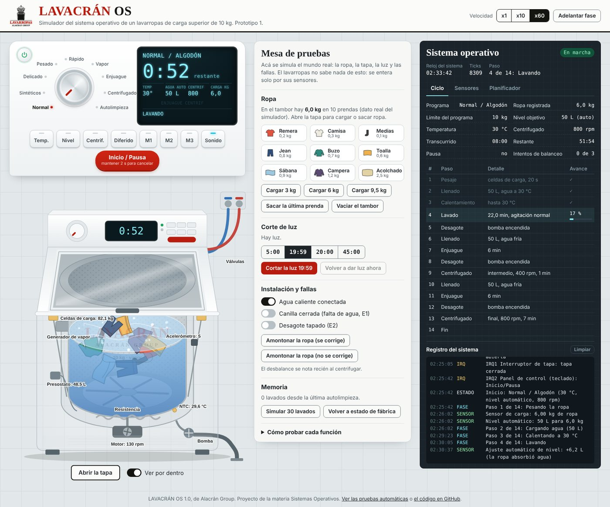

# LAVACRÁN OS

Sistema operativo (simulado) de un **lavarropas de carga superior de 10 kg**, marca Alacrán Group.
Proyecto de la materia Sistemas Operativos. Prototipo 1.

**Pruébalo en el navegador:** https://angelitot.github.io/Proyecto-de-Lavarropas---Sistema-Operativo/
También funciona sin internet: descarga el repositorio y abre `index.html` con doble clic.

**Pruebas automáticas:** [`pruebas.html`](pruebas.html) verifica las 30 reglas acordadas en segundos.



## Qué hay en la pantalla

- **Panel de control**: perilla con 9 programas, pantalla digital y teclas (Temp., Nivel, Centrif., Diferido, M1–M3, Sonido, Inicio/Pausa).
- **El lavarropas**: se ve el agua subir, la ropa girar, el vapor, la resistencia y el motor. «Ver por dentro» vuelve transparente el gabinete y muestra cada sensor con su lectura.
- **Mesa de pruebas**: simula el mundo real: cargar ropa, abrir la tapa, cortar la luz, cerrar la canilla, tapar el desagote, amontonar la ropa.
- **Sistema operativo**: el plan de pasos del ciclo, los sensores, el planificador de tareas, las interrupciones y el registro de todo lo que decide el SO.

La simulación corre a x60 (1 minuto de lavado = 1 segundo). «Adelantar fase» salta al paso siguiente.

## Funciones y dónde están en el código

| # | Función | Cómo se comporta | Código |
|---|---|---|---|
| 1 | Panel de control digital | Programa, temperatura, nivel y centrifugado desde la perilla y las teclas | `js/panel/control.js`, `js/panel/panel.js` |
| 2 | Sensor automático de carga | Pesa la ropa 20 s antes de cargar agua y adapta agua y duración | `js/sensores/sensores.js` |
| 3 | Ajuste automático del nivel | 20 L + 5 L por kg (entre 25 y 70 L). Mientras lava, repone el agua que absorbe la ropa | `js/sensores/sensores.js`, `js/nucleo/ciclo.js` |
| 4 | Lavado con vapor | Programa Vapor / Higiene: lava a 40 °C y después 12 min de vapor a ~75 °C | `js/nucleo/programas.js`, `js/nucleo/ciclo.js` |
| 5 | Lavado rápido | Hasta 3 kg, termina en menos de 30 min | `js/nucleo/programas.js` |
| 6 | Autolimpieza del tambor | Solo con el tambor vacío. Avisa cada 30 lavados | `js/nucleo/programas.js`, `js/panel/memoria.js` |
| 7 | Inicio diferido | "Inicia en X horas": de 30 min a 24 h | `js/panel/diferido.js` |
| 8 | Carga excesiva | Máximo 10 kg; Sintéticos 5 kg, Delicado y Rápido 3 kg. Código E3 | `js/sensores/sensores.js` |
| 9 | Tapa de cierre suave | Nunca se traba. Abrir = pausa; cerrar = sigue solo | `js/seguridad/tapa.js` |
| + | Memoria de programas | M1, M2, M3 (mantener 1,5 s para guardar) y recuerda el último usado | `js/panel/memoria.js` |
| + | Selección de temperatura | Fría, 30, 40 y 60 °C. Usa el agua caliente de red si está conectada | `js/nucleo/ciclo.js` |
| + | Centrifugado ajustable | Sin, 400, 600 y 800 rpm. Se puede cambiar con el programa en marcha | `js/panel/control.js` |
| + | Agregar ropa en marcha | En cualquier momento. Si pasa el límite se detiene hasta que se saque el exceso | `js/sensores/sensores.js` |
| + | Corte de luz | Hasta 19:59 continúa donde quedó; desde 20:00 desagota y reinicia el programa | `js/seguridad/energia.js` |
| + | Desbalance al centrifugar | Redistribuye la ropa hasta 3 veces; si no puede, centrifuga a 400 rpm (E4) | `js/nucleo/ciclo.js` |
| + | Fallas | E1 falta de agua, E2 desagote tapado | `js/seguridad/alarmas.js` |

Las reglas completas y los valores técnicos están en [`docs/especificacion.md`](docs/especificacion.md).
Cómo funciona por dentro (planificador, interrupciones, máquina de estados) está en [`docs/arquitectura.md`](docs/arquitectura.md).

## Reparto del trabajo

El primer prototipo ya funciona completo. Desde ahora **cada pareja es dueña de un módulo**: lo prueba, lo mejora, lo documenta y lo presenta en diciembre. **Angel Vázquez es el integrador**: revisa y acepta los Pull Requests para que `main` siempre funcione.

### Pareja 1 · Angel Vázquez y Aldo Riveros · Panel de control
Rama `pareja-1-panel` · Archivos `js/panel/` · Funciones 1 y 7, memoria de programas, temperatura y centrifugado ajustable.
- [ ] Probar todas las teclas en cada estado (reposo, en marcha, pausa, diferido, fin) y anotar los resultados.
- [ ] Mostrar en la pantalla a qué hora termina el lavado cuando hay inicio diferido.
- [ ] Escribir la parte del manual de usuario sobre el panel.
- [ ] Opcional: bloqueo para niños (mantener Temp. + Nivel 3 s).

### Pareja 2 · Abdias Ruiz y Sergio Chamorro · Sensores y hardware simulado
Rama `pareja-2-sensores` · Archivos `js/sensores/`, `js/hardware/` · Funciones 2, 3 y 8, agregar ropa en marcha y detección de desbalance.
- [ ] Explicar con un dibujo el cálculo de agua + ropa (método de la tapa y control cruzado).
- [ ] Probar los casos límite: 9,95 kg, 10,00 kg y 10,06 kg, y los límites por programa.
- [ ] Mejorar el filtro del sensor de peso (por ejemplo, mediana de 5 lecturas) y comparar.
- [ ] Justificar para la presentación la fórmula del nivel automático.

### Pareja 3 · Angel Patiño y Richard Peralta · Núcleo del sistema operativo
Rama `pareja-3-nucleo` · Archivos `js/nucleo/` · Funciones 4, 5 y 6, planificador, interrupciones y máquina de estados.
- [ ] Preparar la explicación del planificador, las interrupciones y la máquina de estados (lo central de la materia).
- [ ] Revisar la duración de cada programa contra la tabla de la especificación.
- [ ] Agregar la opción «Enjuague extra».
- [ ] Mostrar en la consola cuánto tiempo de CPU usa cada tarea.

### Pareja 4 · Thiago Lovera y Miqueas Oliva · Seguridad y eventos
Rama `pareja-4-seguridad` · Archivos `js/seguridad/` · Función 9, corte de luz y códigos de error.
- [ ] Armar la matriz de pruebas: abrir la tapa en cada fase; cortes de 19:59 y 20:00 en cada fase; corte con la tapa abierta y durante el inicio diferido.
- [ ] Avisar si la tapa queda abierta más de 5 minutos con el programa en pausa.
- [ ] Hacer la tabla de códigos de error para el manual.

### Pareja 5 · Pedro González y Alma Cáceres · Animación, sonido y demo
Rama `pareja-5-animacion` · Archivos `js/animacion/`, `css/`, `index.html`.
- [ ] Revisar que se vea bien en celular y en el proyector del aula.
- [ ] Escribir el guion de la demo y grabar el video o la presentación para diciembre.
- [ ] Agregar demos automáticas (por ejemplo, un botón «Corte de 19:59» que arme la situación solo).
- [ ] Mejorar la animación del agua al centrifugar.

**Todos:** antes de cada Pull Request, abrir `pruebas.html` y confirmar que todas las pruebas pasan. Cada pareja escribe su parte del manual y prepara 3 o 4 minutos de presentación.

### Cronograma hasta el examen final

| Fechas | Qué se hace |
|---|---|
| 2 al 8 de noviembre | Cada pareja estudia su módulo, usa la demo, corre las pruebas y anota dudas |
| 9 al 22 de noviembre | Mejoras y pruebas de cada módulo, una rama por pareja y Pull Request a `main` |
| 23 al 29 de noviembre | Manual de usuario, diagramas y código congelado |
| Diciembre | Ensayo general, video y presentación |

## Cómo trabajar con GitHub

Resumen (la guía paso a paso, también con GitHub Desktop, está en [`docs/guia-git.md`](docs/guia-git.md)):

```bash
git clone https://github.com/Angelitot/Proyecto-de-Lavarropas---Sistema-Operativo.git
cd Proyecto-de-Lavarropas---Sistema-Operativo
git switch pareja-2-sensores          # tu rama
# ... cambios ...
git add .
git commit -m "Sensores: filtro de mediana para el peso"
git push
```
Después, en GitHub, se abre un Pull Request de tu rama hacia `main` y Angel lo revisa.

## Estructura

```
index.html            simulador
pruebas.html          pruebas automáticas en el navegador
css/estilos.css
js/config.js          todos los valores técnicos en un solo lugar
js/nucleo/            núcleo: reloj, interrupciones, planificador, ciclo, programas, EEPROM, consola
js/hardware/          lavarropas físico simulado (agua, motor, ropa, sensores, actuadores)
js/sensores/          carga, nivel automático, sobrecarga, desbalance
js/seguridad/         tapa, corte de luz, alarmas
js/panel/             teclas, memoria de programas, inicio diferido, dibujo del panel
js/animacion/         dibujo del lavarropas, sonidos, mesa de pruebas
tests/                pruebas (también corren con: node tests/correr-en-node.js)
docs/                 especificación, arquitectura y guía de Git
assets/               logo de Alacrán Group
```

No hace falta instalar nada: es HTML, CSS y JavaScript puro.
