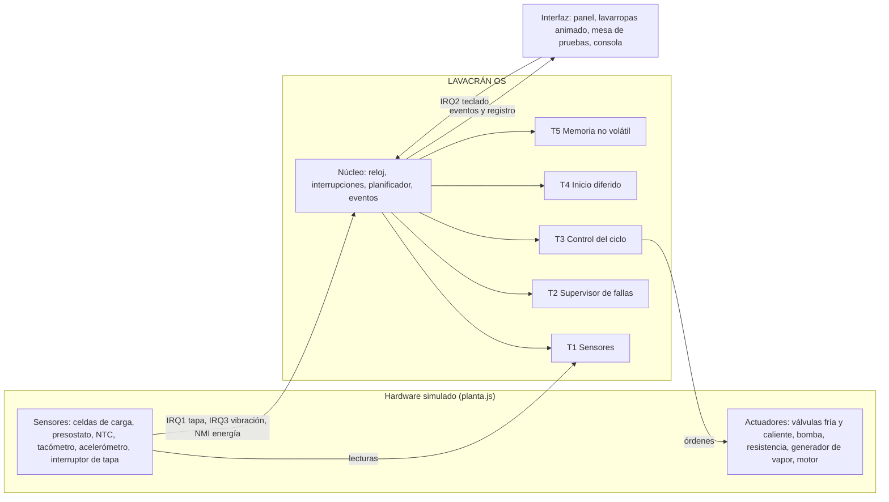
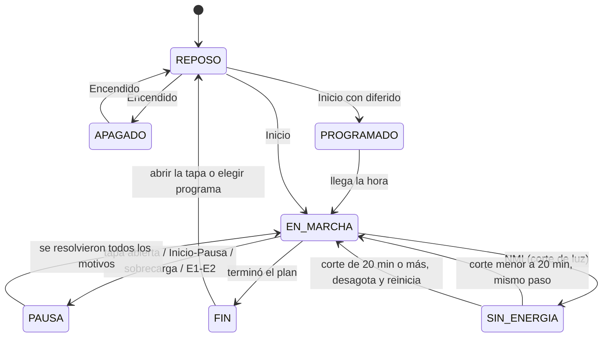
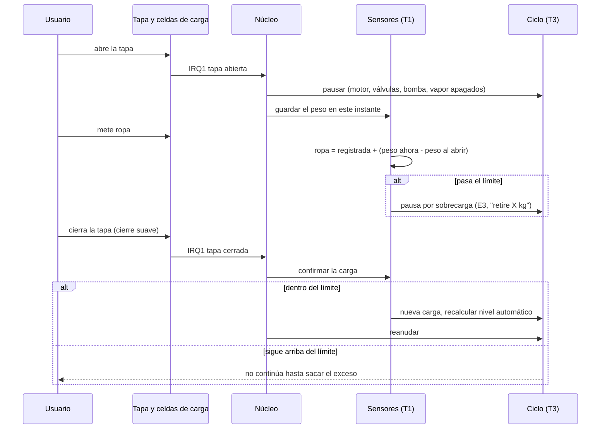
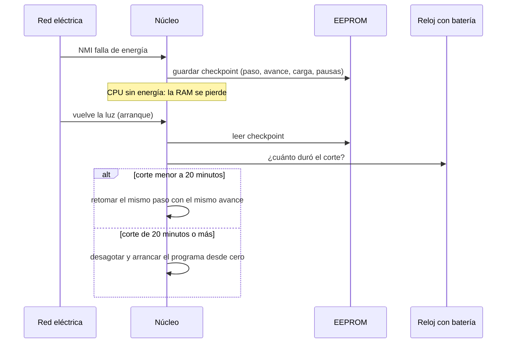

# Cómo funciona LAVACRÁN OS por dentro

El simulador separa tres cosas, igual que en un lavarropas real:

1. **El hardware** (`js/hardware/planta.js`): agua, ropa, temperatura, motor, válvulas, bomba, resistencia, vapor y sensores. Es "el mundo físico".
2. **El sistema operativo** (`js/nucleo`, `js/sensores`, `js/seguridad`, `js/panel`): solo lee sensores y da órdenes a los actuadores. Nunca toca el agua o la ropa directamente.
3. **La interfaz** (`js/animacion`, `js/panel/panel.js`, `js/nucleo/consola.js`): dibuja todo y deja simular situaciones.

## El núcleo (`js/nucleo/kernel.js`)

### Reloj y ticks
El reloj del sistema avanza de a **ticks de 100 ms**. En cada tick:
1. El hardware simulado avanza 100 ms (el agua entra, el motor acelera, la ropa absorbe).
2. Si hay energía, el núcleo atiende las interrupciones pendientes.
3. El planificador ejecuta las tareas cuyo período se cumplió.

La página corre a x1, x10 o x60: a x60 hace 600 ticks por segundo real.

### Interrupciones

| Línea | Dispositivo | Prioridad | Qué hace la rutina de servicio (ISR) |
|---|---|---|---|
| NMI | Falla de energía | máxima (no enmascarable) | Guarda el estado en la EEPROM antes de apagarse |
| IRQ0 | Temporizador del sistema | 0 | Cuenta los ticks |
| IRQ1 | Interruptor de tapa | 1 | Corta el vapor, pausa o reanuda el ciclo, mide la ropa agregada |
| IRQ2 | Panel de control (teclado) | 2 | Ejecuta la tecla según el estado |
| IRQ3 | Acelerómetro | 3 | Ante desbalance, inserta los pasos de redistribución o limita a 400 rpm |

Las interrupciones se atienden apenas llegan, ordenadas por prioridad, y antes que las tareas. Sin energía solo puede entrar la NMI: las demás se pierden (por eso al volver la luz se relee la tapa).

### Planificador de tareas
Prioridades fijas, estilo RTOS: en cada tick se recorren las tareas de mayor a menor prioridad y se ejecutan las que ya cumplieron su período.

| Tarea | Prioridad | Período | Trabajo |
|---|---|---|---|
| T1 Sensores | 1 | 100 ms | Lee todos los sensores, filtra el peso (promedio de 1 s), vigila la ropa agregada y la vibración |
| T2 Supervisor de fallas | 2 | 1 s | Detecta E1 (no sube el agua) y E2 (no baja el agua) |
| T3 Control del ciclo | 3 | 200 ms | Ejecuta el paso actual de la máquina de estados |
| T4 Inicio diferido | 4 | 1 s | Arranca el programa a la hora programada |
| T5 Memoria no volátil | 5 | 5 s | Guarda un checkpoint del estado |

La pestaña **Planificador** de la consola muestra cuántas veces corrió cada tarea y cuántas veces llegó cada interrupción.

## Máquina de estados (`js/nucleo/ciclo.js`)

Dentro de `EN_MARCHA` el ciclo ejecuta un **plan**: una lista de pasos que arma `js/nucleo/programas.js` según el programa elegido. Por ejemplo, Normal:

```mermaid
flowchart LR
  P[Pesaje] --> L1[Llenado] --> C[Calentamiento] --> LV[Lavado] --> D1[Desagote]
  D1 --> L2[Llenado] --> E1[Enjuague 1] --> D2[Desagote] --> CI[Centrifugado intermedio]
  CI --> L3[Llenado] --> E2[Enjuague 2] --> D3[Desagote] --> CF[Centrifugado final] --> F[Fin]
```

Una pausa puede tener **varios motivos a la vez** (por ejemplo, tapa abierta y sobrecarga). El ciclo recién sigue cuando no queda ninguno.

Ante un desbalance, la IRQ3 inserta en el plan, antes del centrifugado: Frenado → Llenado de 15 L → Agitación suave 30 s → Desagote → Centrifugado de nuevo.

## Agregar ropa con el lavarropas funcionando

## Corte de luz y memoria no volátil (`js/seguridad/energia.js`)

El checkpoint también se guarda cada 5 s y en cada cambio de paso, por si el aviso de la NMI no llegara a tiempo.

## Eventos para la interfaz

El núcleo publica eventos (`kernel.emit`) que la interfaz escucha sin tocar la lógica:
`log`, `ciclo:inicio`, `ciclo:paso`, `ciclo:pausa`, `ciclo:reanuda`, `ciclo:fin`, `tapa`, `energia`, `alarma`, `aviso`, `diferido`, `panel`.

Así cada pareja trabaja en su archivo sin pisarse: la lógica no depende del dibujo y las pruebas corren sin abrir la página.
